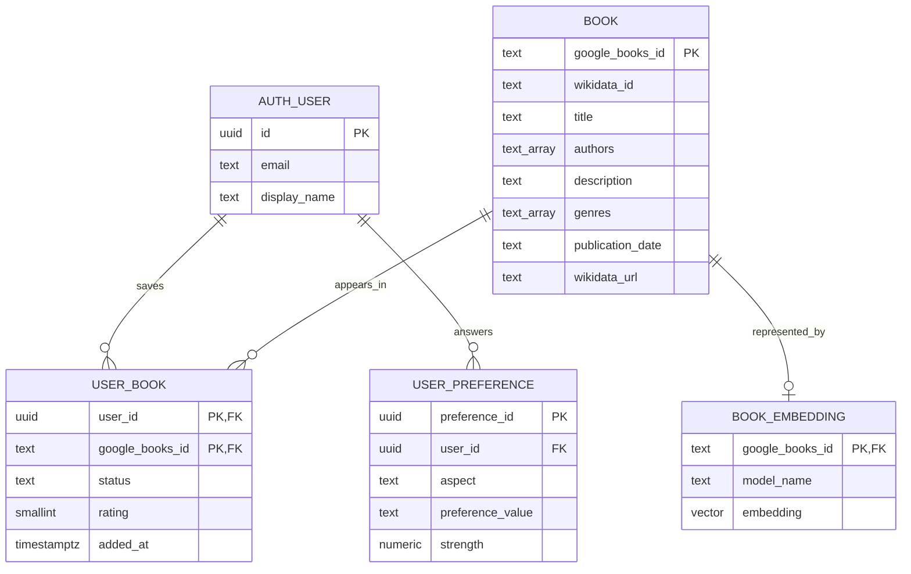
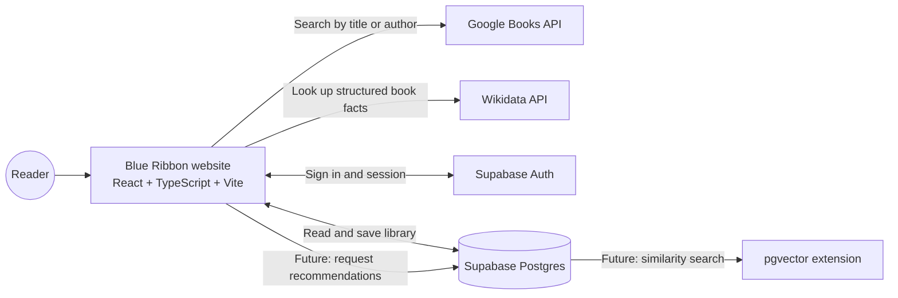

# Blue Ribbon — Initial Project Design

## Project purpose and goals

Blue Ribbon is a responsive book-discovery and reading-tracker website. A reader can search for a book, open an overview, and save it to a personal library. The longer-term goal is to recommend books based on what each reader likes—including themes, genre, reading difficulty, length, complexity, and their own ratings—instead of relying only on broad popularity or genre labels.

- Make it easy to search for an individual book and review its available details.
- Let a signed-in reader save books and keep a personal reading list across devices.
- Track reading status and ratings, then collect more specific preference feedback.
- Build recommendations that can explain why a book may be a good fit.
- Prototype semantic/vector search if there is enough time after the core library works.

## Initial data model / ERD

The first two entities and their relationship support accounts with personal libraries. `USER_PREFERENCES` and `BOOK_EMBEDDINGS` are planned additions for recommendations; they are not part of the current database migrations yet.

**Relationship notes:** `USER_BOOK` is the join table that lets one user save many books and lets one catalog book appear in many users' libraries. A user's rating and reading status belong on that relationship because they are specific to that user's experience of the book. Preference and embedding records are future recommendation data.

## Rough system design

**Main interactions:** The browser searches Google Books and displays results. When a reader opens an overview, the app looks for a matching Wikidata item and shows a source link when it finds one. Supabase Auth manages accounts; Supabase Postgres stores catalog and per-user library records. In a later phase, preference answers and book data can be turned into vectors and compared with pgvector to help rank recommendations.

## Rough user flow

## Initial daily goals through the December 16, 2026 deadline

| Date        | Goal                                                                                      |
| ----------- | ----------------------------------------------------------------------------------------- |
| Wed, Nov 18 | Write down the project scope, MVP, and initial system/data diagrams.                      |
| Thu, Nov 19 | Review the current app flow and make a short list of gaps to the MVP.                     |
| Fri, Nov 20 | Confirm the Supabase schema and apply the required book-library migrations.               |
| Sat, Nov 21 | Try several searches and note where results or Wikidata matches are incomplete.           |
| Sun, Nov 22 | Catch up on notes and adjust the remaining work to the course schedule.                   |
| Mon, Nov 23 | Improve the search-to-overview flow and make the back action clear.                       |
| Tue, Nov 24 | Improve loading, no-match, and error states on the overview page.                         |
| Wed, Nov 25 | Confirm saving, loading, and removing books works for a signed-in account.                |
| Thu, Nov 26 | Review the user-library fields and decide how reading status and ratings should work.     |
| Fri, Nov 27 | Add or refine reading status and rating controls.                                         |
| Sat, Nov 28 | Sketch a short preference questionnaire about themes, genre, difficulty, and length.      |
| Sun, Nov 29 | Refine the preference questions and identify which answers should affect recommendations. |
| Mon, Nov 30 | Add database fields/tables for user preference feedback.                                  |
| Tue, Dec 1  | Create an explainable, rule-based recommendation approach as the first baseline.          |
| Wed, Dec 2  | Implement a first recommendation list using saved books and preference answers.           |
| Thu, Dec 3  | Add a short “why this was recommended” explanation for each result.                       |
| Fri, Dec 4  | Try the recommendation flow with a few different sample reader profiles.                  |
| Sat, Dec 5  | Review which book metadata is available and decide what can power matching.               |
| Sun, Dec 6  | Catch up, write down open questions, and keep the scope realistic.                        |
| Mon, Dec 7  | If the baseline works, sketch the vector-search data flow and required schema.            |
| Tue, Dec 8  | Prototype vector storage/search with a small set of permitted book facts, if time allows. |
| Wed, Dec 9  | Compare the prototype's results with the rule-based baseline; document limitations.       |
| Thu, Dec 10 | Check account ownership rules and make sure users only access their own library.          |
